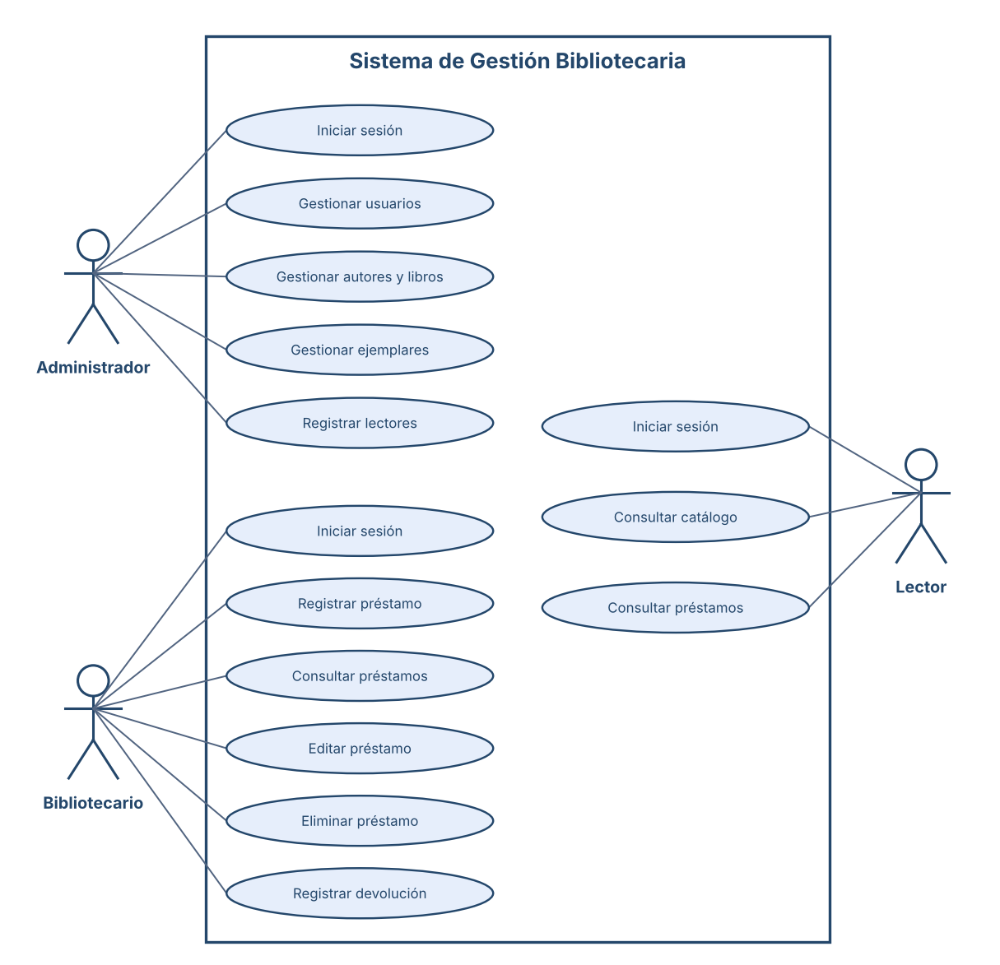
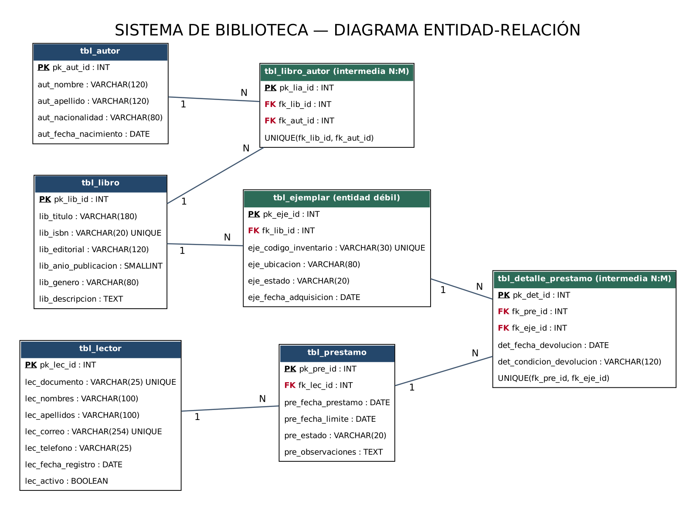

# Sistema de Biblioteca

## Descripción
Sistema de información web para gestionar una biblioteca: catálogo de libros y autores, ejemplares físicos, lectores y préstamos. Está pensado para el personal bibliotecario, que registra y controla los préstamos desde una interfaz propia, y para el administrador, que gestiona todos los datos desde el panel de administración de Django.

## Integrantes
- Jhonner Bernal – Jhobe01
- Donhard Correa – Tuusje
- Ronald Carmona – yesithcarmonaoviedo-spec

## Tecnologías


- Django 5.2 (base de datos SQLite)
- Bootstrap 5.3.3 y Bootstrap Icons 1.11.3, incluidos **por CDN** en `templates/base.html` (se necesita conexión a internet para ver los estilos)
- Estilos propios y paleta de colores en `static/css/estilos.css`

## Tablas principales
| Tabla | Descripción |
| --- | --- |
| `tbl_autor` | Autores de los libros |
| `tbl_libro` | Libros del catálogo (un registro por título o tomo) |
| `tbl_ejemplar` | Copias físicas de cada libro (entidad débil de `tbl_libro`, relación 1:N) |
| `tbl_lector` | Personas que piden libros prestados |
| `tbl_prestamo` | Cabecera del préstamo: lector, fechas y estado (relación 1:N con lector) |
| `tbl_detalle_prestamo` | Tabla intermedia del N:M entre préstamos y ejemplares |
| `tbl_libro_autor` | Tabla intermedia del N:M entre libros y autores |

## Estructura del proyecto
Cada tabla del diagrama es un modelo de Django y vive en **su propia app**. Todas las apps están agrupadas dentro de la carpeta `apps/`.

```text
sistema-biblioteca/
├── apps/
│   ├── __init__.py
│   ├── autores/            # tbl_autor
│   ├── libros/             # tbl_libro (+ catálogo en /libros/)
│   ├── ejemplares/         # tbl_ejemplar (entidad débil de libros)
│   ├── lectores/           # tbl_lector
│   ├── prestamos/          # tbl_prestamo (+ CRUD en /prestamos/)
│   ├── detalle_prestamo/   # tbl_detalle_prestamo (intermedia N:M)
│   └── libro_autor/        # tbl_libro_autor (intermedia N:M)
├── config/                 # settings.py, urls.py y vista de inicio
├── docs/                   # diagramas de actores y entidad-relación
├── static/css/             # estilos propios (paleta de colores)
├── templates/              # base.html y plantillas organizadas por app
├── db.sqlite3              # base de datos con datos de prueba
├── manage.py
├── requirements.txt
└── README.md
```

Cada app contiene su `models.py`, `admin.py`, `apps.py` y su carpeta `migrations/`; las apps `prestamos` y `libros` además tienen `urls.py` (con `app_name`) y `views.py`, y `prestamos` incluye `forms.py`. Las apps se registran en `INSTALLED_APPS` como `apps.<nombre>`.

## Diagramas
- Actores: docs/diagrama_actores.png
- Entidad-relación: docs/diagrama_er.png

### Diagrama de actores (casos de uso)


### Diagrama entidad-relación


Las versiones del segundo corte se conservan como [`docs/diagrama_actores_segundo_corte.png`](docs/diagrama_actores_segundo_corte.png) y [`docs/diagrama_er_segundo_corte.png`](docs/diagrama_er_segundo_corte.png).

## Funcionalidades
- **Proceso con CRUD completo: Préstamos** (lector y ejemplares prestados), desde la interfaz:
  - Listar: `/prestamos/`
  - Crear: `/prestamos/nuevo/`
  - Detalle: `/prestamos/<id>/`
  - Editar: `/prestamos/<id>/editar/`
  - Eliminar (con página de confirmación): `/prestamos/<id>/eliminar/`
- Funcionalidades adicionales:
  - Inicio y cierre de sesión (`/ingresar/`, `/salir/`); todas las páginas exigen sesión (`@login_required`).
  - Panel de inicio con resumen (`/`).
  - Catálogo de libros con búsqueda por título, ISBN o autor y filtro por género (`/libros/`, `/libros/<id>/`).
  - Búsqueda por lector o número y filtro por estado en la lista de préstamos, con paginación.
  - Validaciones: fecha límite no anterior a la del préstamo, ejemplares no repetidos, al menos un ejemplar por préstamo y solo ejemplares disponibles.
  - El estado de los ejemplares se actualiza solo (prestado/disponible) y el préstamo pasa a "devuelto" cuando se devuelven todos sus ejemplares.
  - Mensajes de confirmación y de error.
- El panel de administración sigue disponible en `/admin/`.

## Cómo ejecutar el proyecto
1. git clone <https://github.com/Jhobe01/sistema-biblioteca>
2. python -m venv venv
3. venv\Scripts\activate   (Linux/macOS: source venv/bin/activate)
4. pip install -r requirements.txt
5. python manage.py migrate
6. python manage.py runserver

Luego abre http://127.0.0.1:8000/ e inicia sesión.

## Usuarios de prueba
- Superusuario del admin: usuario `Jhobe` y contraseña `LinkStart`

## Licencia y uso

Proyecto desarrollado con fines académicos.
